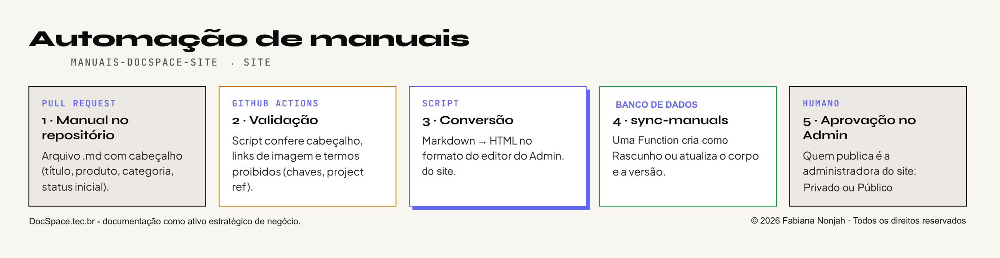
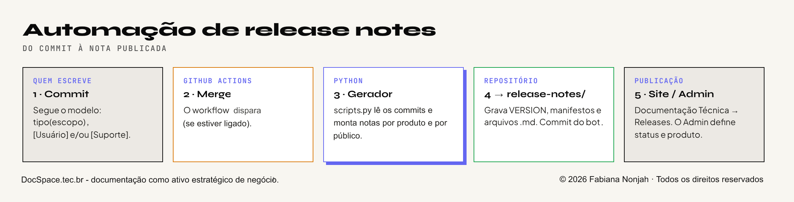

<!-- ANIMATED HEADER -->

  

<h3 align="center">
  
</h3>

  
  &nbsp;
  

<h3 align="center">Senior Technical Writer | Software Documentation | Data Analytics & Artificial Intelligence Projects</h3>

Experiência em documentação de software, gestão do conhecimento e comunicação técnica. Ampliando minha atuação com projetos práticos em análise de dados, inteligência artificial e automação.

  <a href="#sobre-mim">Sobre mim</a> &nbsp;·&nbsp;
  <a href="#projetos-em-destaque">Projetos em destaque</a> &nbsp;·&nbsp;
  <a href="#competências-e-conhecimentos">Competências</a> &nbsp;·&nbsp;
  <a href="#formação-e-desenvolvimento-profissional">Formação</a> &nbsp;·&nbsp;
  <a href="#portfólio-e-presença-profissional">Contato</a>

---

## ✦ Sobre mim

Sou **Analista de Documentação de Software Sênior (Senior Technical Writer)**, com 7+ anos de experiência na criação, estruturação, gestão e melhoria contínua de documentação técnica, bases de conhecimento e conteúdos de apoio para produtos e serviços digitais.

Ao longo da minha trajetória, desenvolvi uma atuação que conecta tecnologia, produto, suporte e experiência do usuário, transformando informações complexas em conhecimento claro, estruturado, acessível e escalável. Tenho especial interesse em arquitetura do conhecimento, consistência editorial, melhoria de processos e inovações.

Atualmente, estou direcionando meus estudos também para **Análise de Dados e Inteligência Artificial**, por meio de formação continuada e desenvolvimento de projetos práticos.

Estou cursando uma capacitação em **Desenvolvimento de IA para Análise Preditiva**, na qual já desenvolvi projetos práticos propostos pelo curso, realizados como atividades avaliativas e publicados aqui no Github.

Sou também **pós-graduanda em Inteligência Artificial Aplicada à Estratégia e à Inovação Empresarial**, ampliando meus conhecimentos sobre as possibilidades de aplicação da IA no contexto de negócio.

Paralelamente, desenvolvo projetos próprios envolvendo desenvolvimento web com IA, agentes inteligentes com RAG, soluções Micro SaaS e automação de processos de documentação.

A experiência como Technical Writing e na Gestão do Conhecimento se soma ao desenvolvimento de novas competências em Análise de Dados e Inteligência Artificial, diversificando meus conhecimentos e construindo novas perspectivas de atuação profissional. Tenho interesse em desafios nas áreas de tecnologia: documentação de software, análise de dados e inteligência artificial. Nesse processo, invisto continuamente em formação e no desenvolvendo de habilidades para conectar tecnologia e soluções, com uma visão multidisciplinar e analítica.

---

## ✦ Projetos em destaque

Projetos práticos em Análise de Dados, Inteligência Artificial e Machine Learning.

(Executados como avaliações no curso de Desenvolvimento de IA para Análise Preditiva)

### ◈ Dados e Machine Learning

<table>
<tr>
<td width="50%" valign="top">

<h3 align="center">Sales Insight PY</h3>

Análise e visualização de dados de vendas com Python, incluindo tratamento de dados, indicadores, segmentação de clientes e geração de gráficos.

**Tecnologias:** Python, Pandas, NumPy, Matplotlib e Seaborn.

<a href="https://github.com/Fabiana444/salesinsight-py">Ver projeto</a> ·
<a href="https://github.com/Fabiana444/Fabiana444/blob/main/assets/projeto-salesinsights_nota.png">Nota</a>

</td>
<td width="50%" valign="top">

<h3 align="center">Machine Learning e Inteligência Artificial</h3>

Projeto de análise de dados e Machine Learning para previsão de cancelamentos de reservas hoteleiras, com EDA, tratamento de dados e engenharia de features.

**Tecnologias:** Python, Pandas e bibliotecas de Machine Learning.

<a href="https://github.com/Fabiana444/Projeto-de-Machine-Learning-e-Inteligencia-Artificial">Ver projeto</a> ·
<a href="https://github.com/Fabiana444/Fabiana444/blob/main/assets/projeto_machine_learning_IA_nota.png">Nota</a>

</td>
</tr>
</table>

### ◈ Inteligência Artificial e Desenvolvimento

Projetos próprios (AI Product Builder) e experimentações voltadas ao desenvolvimento web e aplicações de inteligência artificial.

<table>
<tr>
<td width="50%" valign="top">

<h3 align="center">Agente de IA com RAG</h3>

Agente de IA Cognitiva (IA Generativa + RAG) para transformar a apresentação profissional em uma experiência interativa e conversacional para recrutadores. Permite triagem de soft/hard skills em tempo real, resolução instantânea de dúvidas e direcionamento estratégico para canais de contato.

<a href="https://agente-pre-entrevista.docspace.tec.br/">Acessar projeto →</a>

</td>
<td width="50%" valign="top">

<h3 align="center">DocSpace — Desenvolvimento Web com IA</h3>

Site desenvolvido do zero, sem utilização de WordPress, Wix ou outras plataformas prontas de criação. Toda a estrutura, identidade visual, organização das páginas e funcionalidades foram concebidas e implementadas em um projeto próprio, com desenvolvimento personalizado e controle sobre o código-fonte.

<a href="https://docspace.tec.br/">Visitar DocSpace →</a>

</td>
</tr>
<tr>
<td width="50%" valign="top">

<h3 align="center">CopyMaster — Micro SaaS</h3>

Plataforma de marketing para geração e gestão de copywriting estratégico multicanal em escala. Permite criar copies e cronogramas de campanhas completas distribuídas em 13 canais de comunicação com preservação de tom de voz, UVP e persona. Reduz o tempo de criação de dias para minutos.

**Status:** Produto autoral em desenvolvimento

<a href="https://copymaster.docspace.tec.br/">Conhecer plataforma →</a>

</td>
<td width="50%" valign="top">

<h3 align="center">Manassés — Micro SaaS</h3>

Plataforma de documentação de software baseada em CCMS para criar, editar, publicar e manter conteúdo técnico. Permite documentar aplicações via interface, reutilizar componentes e publicar diferentes formatos a partir de uma única fonte. Centraliza, padroniza e otimiza a manutenção de documentos.

**Status:** Produto autoral em desenvolvimento

**Em breve!**

</td>
</tr>
</table>

Os códigos-fonte estão em repositórios privados. Os links direcionam para as aplicações disponíveis em produção.

### ◈ Automações

Fluxos de automação desenvolvidos e ativos, com publicação de conteúdos no site de desenvolvimento próprio: [DocSpace.tec](https://docspace.tec.br/documentacao-tecnica/).

**Automação de manuais de produto**

**Automação de release notes**

---

## ✦ Competências e conhecimentos

<table>
<tr>
<td width="50%" valign="top">

### Documentação de Software e Gestão do Conhecimento

- Documentação como código
- Inteligência artificial aplicada à produtividade e à documentação
- Automação de processos e tarefas
- Boas práticas para documentação de produtos digitais (SaaS)
- Knowledge Management

</td>
<td width="50%" valign="top">

### Dados e Inteligência Artificial

- Análise de Dados
- Análise Exploratória de Dados
- Inteligência Artificial e IA Preditiva
- Agentes de IA e arquitetura RAG
- Desenvolvimento web com apoio de IA
- Conceitos e desenvolvimento de soluções Micro SaaS (back-end e front-end)

</td>
</tr>
</table>

---

## ✦ Formação e desenvolvimento profissional

- Capacitação em Desenvolvimento de IA para Análise Preditiva — em andamento.
- Pós-graduação em Inteligência Artificial Aplicada à Estratégia e à Inovação Empresarial — em andamento.
- Pós-graduação em Marketing (2022)
- Comunicação Social - Jornalismo (2005)
- Inglês: Intermediário — leitura técnica e ferramentas

---

## ✦ Portfólio e presença profissional

&nbsp;&nbsp;

Technical Writing · Software Documentation · Technical Documentation · Knowledge Management · Knowledge Base · Information Architecture · UX Writing · Documentation as Code · Markdown · Data Analysis · Exploratory Data Analysis · Data Visualization · Artificial Intelligence (AI) · Predictive Analytics · AI Agents · Retrieval-Augmented Generation (RAG) · Workflow Automation · GitHub Actions · Process Improvement · Continuous Improvement

<!-- ANIMATED FOOTER -->

  

