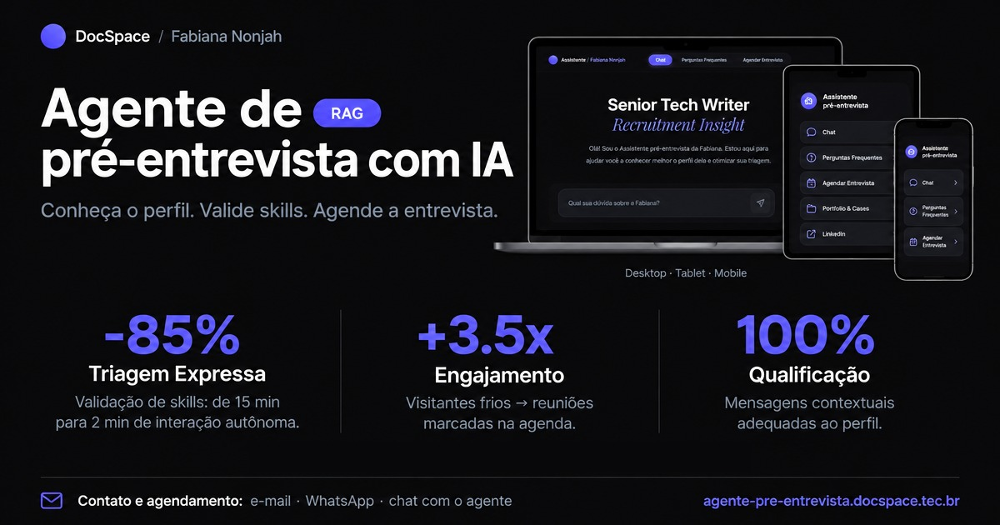
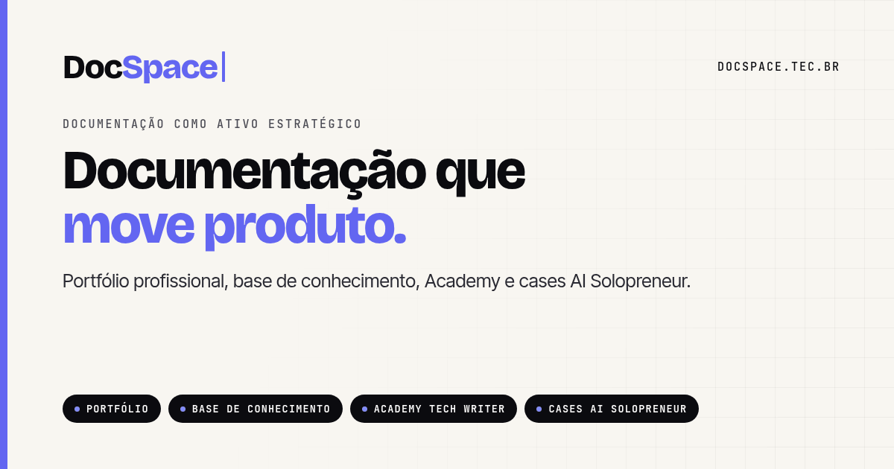
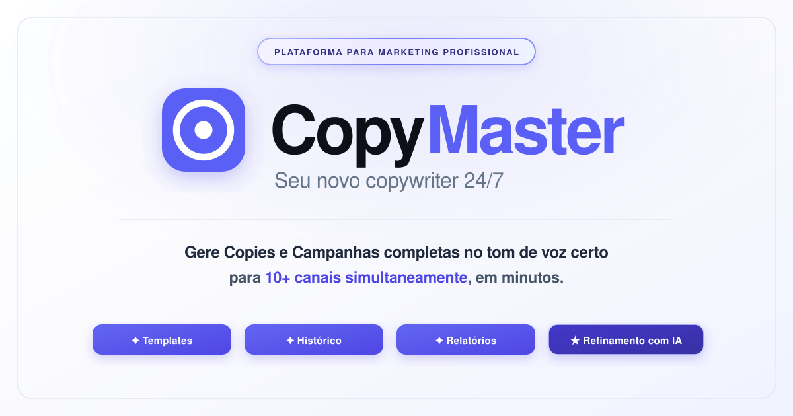

# Fabiana Nonjah

### Senior Technical Writer | Software Documentation | Data Analytics & Artificial Intelligence Projects

Experiência em documentação de software, gestão do conhecimento e comunicação técnica. Ampliando minha atuação com projetos práticos em análise de dados, inteligência artificial e automação.

[LinkedIn](https://www.linkedin.com/in/fabiana-nonjah-techwriter/) &nbsp;&nbsp;&nbsp; &nbsp;&nbsp;&nbsp; [Portfólio](https://docspace.tec.br/)

---

## Navegação

[Sobre mim](#sobre-mim) &nbsp;&nbsp;&nbsp;· [Projetos em destaque](#projetos-em-destaque) &nbsp;&nbsp;&nbsp;· [Competências e conhecimentos](#competências-e-conhecimentos) &nbsp;&nbsp;&nbsp;· [Formação](#formação-e-desenvolvimento-profissional) &nbsp;&nbsp;&nbsp;· [Contato](#portfólio-e-presença-profissional)

---

## Sobre mim

Sou **Analista de Documentação de Software Sênior (Senior Technical Writer)**, com 7+ anos de experiência na criação, estruturação, gestão e melhoria contínua de documentação técnica, bases de conhecimento e conteúdos de apoio para produtos e serviços digitais.

Ao longo da minha trajetória, desenvolvi uma atuação que conecta tecnologia, produto, suporte e experiência do usuário, transformando informações complexas em conhecimento claro, estruturado, acessível e escalável. Tenho especial interesse em qualidade da informação, arquitetura do conhecimento, consistência editorial e melhoria de processos.

Atualmente, estou direcionando meus estudos também para **Análise de Dados e Inteligência Artificial**, por meio de formação continuada e desenvolvimento de projetos práticos.

Estou cursando uma capacitação em **Desenvolvimento de IA para Análise Preditiva**, na qual já desenvolvi projetos práticos propostos pelo curso, realizados como atividades avaliativas e publicados aqui no Github.

Sou também **pós-graduanda em Inteligência Artificial Aplicada à Estratégia e à Inovação Empresarial**, ampliando meus conhecimentos sobre as possibilidades de aplicação da IA no contexto de negócio.

Paralelamente, desenvolvo projetos próprios envolvendo desenvolvimento web com IA, agentes inteligentes com RAG, soluções Micro SaaS e automação de processos de documentação.

A experiência como Technical Writing e na Gestão do Conhecimento se soma ao desenvolvimento de novas competências em Análise de Dados e Inteligência Artificial, diversificando meus conhecimentos e construindo novas perspectivas de atuação profissional. Tenho interesse em desafios nas áreas de tecnologia: documentação de software, análise de dados e inteligência artificial. Nesse processo, invisto continuamente em formação e no desenvolvendo de habilidades para conectar tecnologia e soluções, com uma visão multidisciplinar e analítica.

---

## Projetos em destaque

Projetos práticos em Análise de Dados, Inteligência Artificial e Machine Learning.

### Dados e Machine Learning

| **SalesInsight PY** | **Machine Learning e Inteligência Artificial** |
|:---:|:---:|
|  |  |
| Análise e visualização de dados de vendas com Python, incluindo tratamento de dados, indicadores, segmentação de clientes e geração de gráficos. | Projeto de análise de dados e Machine Learning para previsão de cancelamentos de reservas hoteleiras, com EDA, tratamento de dados e engenharia de features. |
| **Tecnologias:** Python, Pandas, NumPy, Matplotlib e Seaborn. | **Tecnologias:** Python, Pandas e bibliotecas de Machine Learning. |
| [Ver projeto →](https://github.com/Fabiana444/salesinsight-py) | [Ver projeto →](https://github.com/Fabiana444/Projeto-de-Machine-Learning-e-Inteligencia-Artificial) |

 

### Inteligência Artificial e Desenvolvimento

Projetos e experimentações voltados ao desenvolvimento web e aplicações de inteligência artificial.

| **Agente de IA com RAG** | **DocSpace — Desenvolvimento Web com IA** |
|:---:|:---:|
|  |  |
| Agente de IA Cognitiva (IA Generativa + RAG) para transformar a apresentação profissional em uma experiência interativa de autoatendimento para recrutadores e gestores de tecnologia. |
| [Acessar projeto →](https://agente-pre-entrevista.docspace.tec.br/) | [Visitar DocSpace →](https://docspace.tec.br/) |
| **CopyMaster — Micro SaaS** | **Próximo projeto** |
|  | |
| Desenvolvimento de uma solução digital própria no formato Micro SaaS. | |
| **Status:** Desenvolvimento de produto próprio | |
| [Conhecer plataforma →](https://copymaster.docspace.tec.br/) | |

Os códigos-fonte estão em repositórios privados. Os links direcionam às aplicações disponíveis em produção.

### Automação e Documentação

- **Automação de documentação:** experimentação com GitHub Actions para geração de release notes e manuais técnicos.

---

## Competências e conhecimentos

**Documentação de Software e Gestão do Conhecimento**

- Documentação como código
- Inteligência artificial aplicada à produtividade e à documentação
- Automação de processos e tarefas
- Boas práticas para documentação de produtos digitais (SaaS)
- Knowledge Management

   

**Dados e Inteligência Artificial**

- Análise de Dados
- Análise Exploratória de Dados
- Inteligência Artificial e IA Preditiva
- Agentes de IA e arquitetura RAG
- Desenvolvimento web com apoio de IA
- Conceitos e desenvolvimento de soluções Micro SaaS (back-end e front-end)

---

## Formação e desenvolvimento profissional

- Capacitação em Desenvolvimento de IA para Análise Preditiva — em andamento.
- Pós-graduação em Inteligência Artificial Aplicada à Estratégia e à Inovação Empresarial — início da formação.
- Pós-graduação em Marketing (2022)
- Comunicação Social - Jornalismo (2005)
- Inglês: Intermediário — leitura técnica e ferramentas

---

## Portfólio e presença profissional

- Portfólio: [docspace.tec.br](https://docspace.tec.br/)
- LinkedIn: [Fabiana Nonjah - Technical Writer](https://www.linkedin.com/in/fabiana-nonjah-techwriter/)

---

 
Technical Writing · Software Documentation · Technical Documentation · Knowledge Management · Knowledge Base · Information Architecture · UX Writing · Documentation as Code · Markdown · Data Analysis · Exploratory Data Analysis · Data Visualization · Artificial Intelligence (AI) · Predictive Analytics · AI Agents · Retrieval-Augmented Generation (RAG) · Workflow Automation · GitHub Actions · Process Improvement · Continuous Improvement
