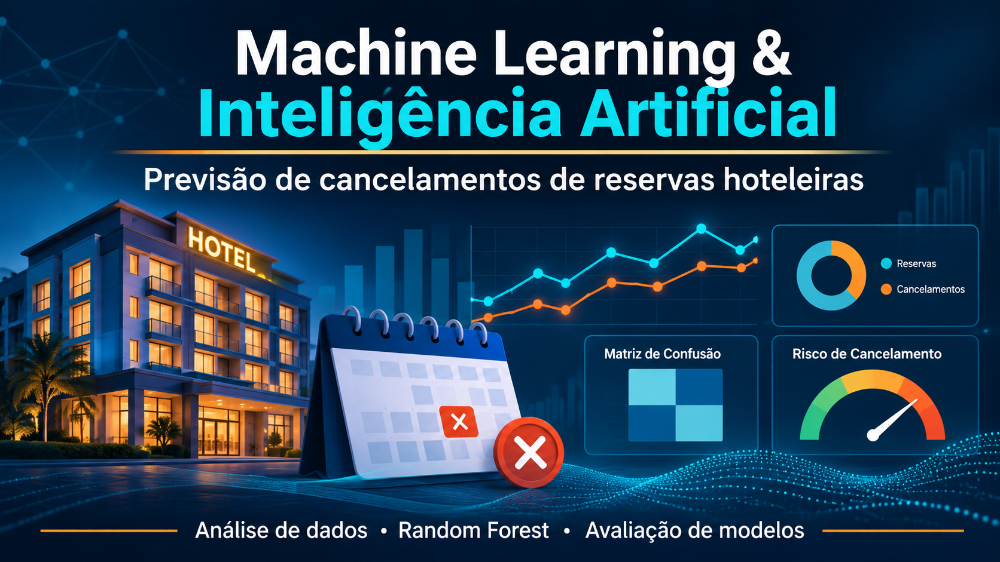
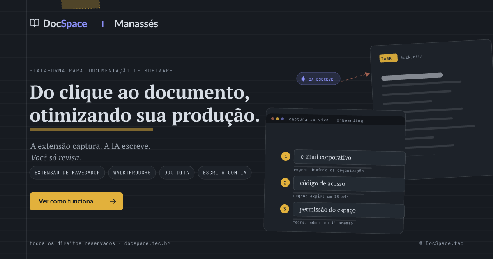

# Fabiana Nonjah

 

  

### Senior Technical Writer | Software Documentation | Data Analytics & Artificial Intelligence Projects

Experiência em documentação de software, gestão do conhecimento e comunicação técnica. Ampliando minha atuação com projetos práticos em análise de dados, inteligência artificial e automação.

---

    [Sobre mim](https://github.com/Fabiana444#sobre-mim)    · [Projetos em destaque](https://github.com/Fabiana444#projetos-em-destaque)    · [Competências e conhecimentos](https://github.com/Fabiana444#compet%C3%AAncias-e-conhecimentos)    · [Formação](https://github.com/Fabiana444#forma%C3%A7%C3%A3o-e-desenvolvimento-profissional)    · [Contato](https://github.com/Fabiana444#portf%C3%B3lio-e-presen%C3%A7a-profissional)

---

## Sobre mim

Sou **Analista de Documentação de Software Sênior (Senior Technical Writer)**, com 7+ anos de experiência na criação, estruturação, gestão e melhoria contínua de documentação técnica, bases de conhecimento e conteúdos de apoio para produtos e serviços digitais.

Ao longo da minha trajetória, desenvolvi uma atuação que conecta tecnologia, produto, suporte e experiência do usuário, transformando informações complexas em conhecimento claro, estruturado, acessível e escalável. Tenho especial interesse em arquitetura do conhecimento, consistência editorial, melhoria de processos e inovações.

Atualmente, estou direcionando meus estudos também para **Análise de Dados e Inteligência Artificial**, por meio de formação continuada e desenvolvimento de projetos práticos.

Estou cursando uma capacitação em **Desenvolvimento de IA para Análise Preditiva**, na qual já desenvolvi projetos práticos propostos pelo curso, realizados como atividades avaliativas e publicados aqui no Github.

Sou também **pós-graduanda em Inteligência Artificial Aplicada à Estratégia e à Inovação Empresarial**, ampliando meus conhecimentos sobre as possibilidades de aplicação da IA no contexto de negócio.

Paralelamente, desenvolvo projetos próprios envolvendo desenvolvimento web com IA, agentes inteligentes com RAG, soluções Micro SaaS e automação de processos de documentação.

A experiência como Technical Writing e na Gestão do Conhecimento se soma ao desenvolvimento de novas competências em Análise de Dados e Inteligência Artificial, diversificando meus conhecimentos e construindo novas perspectivas de atuação profissional. Tenho interesse em desafios nas áreas de tecnologia: documentação de software, análise de dados e inteligência artificial. Nesse processo, invisto continuamente em formação e no desenvolvendo de habilidades para conectar tecnologia e soluções, com uma visão multidisciplinar e analítica.

---

## Projetos em destaque

Projetos práticos em Análise de Dados, Inteligência Artificial e Machine Learning.

(Executados como avaliações no curso de Desenvolvimento de IA para Análise Preditiva)

### Dados e Machine Learning

| **Sales Insight PY** | **Machine Learning e Inteligência Artificial** |
| -------------------------------------------------------------------------------------------------------------------------------------------------------------------- | ------------------------------------------------------------------------------------------------------------------------------------------------------------------------------------------------------------------------------------------------------------------- |
|  |  |
| Análise e visualização de dados de vendas com Python, incluindo tratamento de dados, indicadores, segmentação de clientes e geração de gráficos. | Projeto de análise de dados e Machine Learning para previsão de cancelamentos de reservas hoteleiras, com EDA, tratamento de dados e engenharia de features. |
| **Tecnologias:** Python, Pandas, NumPy, Matplotlib e Seaborn. | **Tecnologias:** Python, Pandas e bibliotecas de Machine Learning. |
| [Ver projeto](https://github.com/Fabiana444/salesinsight-py)    [Nota](https://github.com/Fabiana444/Fabiana444/blob/main/assets/projeto-salesinsights_nota.png) | [Ver projeto](https://github.com/Fabiana444/Projeto-de-Machine-Learning-e-Inteligencia-Artificial)    [Nota](https://github.com/Fabiana444/Fabiana444/blob/main/assets/projeto_machine_learning_IA_nota.png) |

### Inteligência Artificial e Desenvolvimento

Projetos próprios (AI Product Builder) e experimentações voltadas ao desenvolvimento web e aplicações de inteligência artificial.

| **Agente de IA com RAG** | **DocSpace — Desenvolvimento Web com IA** |
| ---------------------------------------------------------------------------------------------------------------------------------------------------------------------------------------------------------------------------------------------------------------------------------------------------- | --------------------------------------------------------------------------------------------------------------------------------------------------------------------------------------------------------------------------------------------------------------------------------------------------------------- |
|  |  |
| Agente de IA Cognitiva (IA Generativa + RAG) para transformar a apresentação profissional em uma experiência interativa e conversacional para recrutadores. Permite triagem de soft/hard skills em tempo real, resolução instantânea de dúvidas e direcionamento estratégico para canais de contato. | Site desenvolvido do zero, sem utilização de WordPress, Wix ou outras plataformas prontas de criação. Toda a estrutura, identidade visual, organização das páginas e funcionalidades foram concebidas e implementadas em um projeto próprio, com desenvolvimento personalizado e controle sobre o código-fonte. |
| [Acessar projeto →](https://agente-pre-entrevista.docspace.tec.br/) | [Visitar DocSpace →](https://docspace.tec.br/) |

| **CopyMaster — Micro SaaS** | **Manassés — Micro SaaS** |
| ---------------------------------------------------------------------------------------------------------------------------------------------------------------------------------------------------------------------------------------------------------------------------------------------- | ---------------------------------------------------------------------------------------------------------------------------------------------------------------------------------------------------------------------------------------------------------------------------------------------------------- |
|  |  |
| Plataforma de marketing para geração e gestão de copywriting estratégico multicanal em escala. Permite criar copies e cronogramas de campanhas completas distribuídas em 13 canais de comunicação com preservação de tom de voz, UVP e persona. Reduz o tempo de criação de dias para minutos. | Plataforma de documentação de software baseada em CCMS para criar, editar, publicar e manter conteúdo técnico. Permite documentar aplicações via interface, reutilizar componentes e publicar diferentes formatos a partir de uma única fonte. Centraliza, padroniza e otimiza a manutenção de documentos. |
| **Status:** Produto autoral em desenvolvimento | **Status:** Produto autoral em desenvolvimento |
| [Conhecer plataforma →](https://copymaster.docspace.tec.br/) | **Em breve!** |

Os códigos-fonte estão em repositórios privados. Os links direcionam para as aplicações disponíveis em produção.

### Automações

Fluxos de automação desenvolvidos e ativos, com publicação de conteúdos no site de desenvolvimento próprio: [DocSpace.tec](https://docspace.tec.br/documentacao-tecnica/).

**Automação de manuais de produto**

[Fluxo de automação de manuais do DocSpace](https://raw.githubusercontent.com/Fabiana444/Fabiana444/main/assets/automacao_manuais_docspace_site.png)

**Automação de release notes**

[Fluxo de automação de release notes do DocSpace](https://raw.githubusercontent.com/Fabiana444/Fabiana444/main/assets/automacao_release_notes_site.png)

## Competências e conhecimentos

**Documentação de Software e Gestão do Conhecimento**

- Documentação como código
- Inteligência artificial aplicada à produtividade e à documentação
- Automação de processos e tarefas
- Boas práticas para documentação de produtos digitais (SaaS)
- Knowledge Management

**Dados e Inteligência Artificial**

- Análise de Dados
- Análise Exploratória de Dados
- Inteligência Artificial e IA Preditiva
- Agentes de IA e arquitetura RAG
- Desenvolvimento web com apoio de IA
- Conceitos e desenvolvimento de soluções Micro SaaS (back-end e front-end)

---

## Formação e desenvolvimento profissional

- Capacitação em Desenvolvimento de IA para Análise Preditiva — em andamento.
- Pós-graduação em Inteligência Artificial Aplicada à Estratégia e à Inovação Empresarial — em andamento.
- Pós-graduação em Marketing (2022)
- Comunicação Social - Jornalismo (2005)
- Inglês: Intermediário — leitura técnica e ferramentas

---

## Portfólio e presença profissional

[LinkedIn](https://www.linkedin.com/in/fabiana-nonjah-techwriter/)         [Portfólio](https://docspace.tec.br/)

---

Technical Writing · Software Documentation · Technical Documentation · Knowledge Management · Knowledge Base · Information Architecture · UX Writing · Documentation as Code · Markdown · Data Analysis · Exploratory Data Analysis · Data Visualization · Artificial Intelligence (AI) · Predictive Analytics · AI Agents · Retrieval-Augmented Generation (RAG) · Workflow Automation · GitHub Actions · Process Improvement · Continuous Improvement

  

